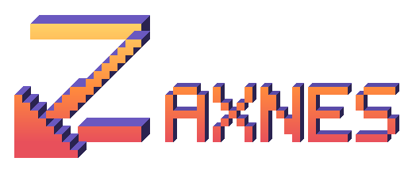

<p align="center">
  
</p>

# Zaxnes

**Zaxnes** is a free, **GPL-3.0 NES emulator that renders games in 3D**: each frame's tiles and
sprites are turned into extruded 3D objects, placed in a scene and drawn with a real camera,
lighting and shadows. A *3D profile* describes, per game, which patterns become which geometry,
and carries Lua scripts that drive the scene while the game plays.

It runs on **Windows**, **Linux** and **aarch64 handhelds** through PortMaster (Anbernic H700
devices such as the RG40XXV and the RG35XX family, on muOS, Knulli or ROCKNIX).

> **Independent project, not affiliated with Geod Studio or Nintendo. NES is a trademark of
> Nintendo.**

Zaxnes is distributed under the **GNU General Public License v3** ([LICENSE](LICENSE)). Part of
the 2D → 3D conversion engine (`rust/crates/zax-engine3d`) is adapted from **3DNes_Engine**
(© Geod Studio), an earlier, publicly released GPL-3.0 version of that engine — the files
concerned carry an attribution header, and that licence is why Zaxnes is GPL-3.0 too. It
contains **no file taken from 3dSen**.

> Zaxnes 0.3.0 is written in **Rust**. Versions 0.1.0 and 0.2.0 were written in C# / .NET;
> that code is kept, unchanged, on the
> [`archive-dotnetversion`](../../tree/archive-dotnetversion) branch.

## Download

Every [release](../../releases) carries one package per platform. **None of them contains a
ROM or a game profile.**

| Package | Platform | Notes |
|---|---|---|
| `Zaxnes-<version>-win-x64.zip` | Windows 10/11 x64 | a single `zaxnes.exe`, nothing to install |
| `Zaxnes-<version>-linux-x64.tar.gz` | Linux x86_64, glibc 2.31 or newer | needs the system's SDL2 (`libsdl2-2.0-0` on Debian/Ubuntu) |
| `Zaxnes-<version>-portmaster-aarch64.zip` | PortMaster handhelds (aarch64) | unzip into the `ports` folder of the SD card |

The desktop builds draw with **OpenGL 3.3** by default, or with **Vulkan** or (on Windows)
**DirectX 12** (Options ▸ Video ▸ Graphics API, or `--backend vulkan|dx12`). In Vulkan,
post-processing tools such as ReShade read the depth of the 3D scene (ReShade and DirectX 12 do
not work together yet); see [HOWTO-RUN.md](HOWTO-RUN.md). The handheld build uses
**OpenGL ES 3.0**.

## No ROMs, no profiles, no assets from another program

**No ROM is distributed.** Playing a game needs a dump you own legally.

**No game profile is distributed.** The library starts with two generic entries written in
code: « 2D Mode », which plays any ROM without a 3D conversion, and « 3D par défaut (sans
profil) », which converts any ROM with a default geometry. If you legally hold a `.3dn`
profile, **Fichier ▸ Importer un profil…** copies it into your data folder; you can also drop it
into the `profiles` folder next to the executable.

Everything the program shows or plays is **produced by its own code** or read from your machine
at run time **without being redistributed**: the skyboxes and the sun, moon and clouds are
GLSL, the interface sounds are synthesised, and the interface font is one already installed on
your system. [`ASSETS-LICENSES.md`](ASSETS-LICENSES.md) lists every asset and its licence;
[`THIRD-PARTY-NOTICES.md`](THIRD-PARTY-NOTICES.md) lists the third-party code.

### Bring your own 3dSen

If you own 3dSen, its profiles are already on your disk: **Fichier ▸ Importer depuis 3dSen…**
— or `zaxnes --import-3dsen <folder-or-bundle>` — reads the profile bundle of **your**
installation and writes the profiles that decode, unmodified, into your own profile folder.
Nothing is downloaded or redistributed, and the bundle itself is never modified. For a handheld,
run the import on a PC and copy the resulting `profiles/` folder to the card (see the
[PortMaster README](rust/build/portmaster/README.md)).

## Using it

**[HOWTO-RUN.md](HOWTO-RUN.md)** (in French) is the user guide: menus, shortcuts, options, where
files are written, and the full command line.

**Widescreen.** *Zelda II - The Adventure of Link* (USA), *Mega Man 2* (USA) and *Super Mario
Bros. 3* (USA) (Rev 1) can be played in 16:9 (or 3:2, 16:10, or the ratio of the view): a widescreen hack built into the emulator is
applied in memory to the player's own ROM (the patch ships no game data), and the scene shows the
level and the enemies past the original edges. It is turned on per game, in the game's hacks
screen (the [W] of the ROM list). The emulator side is described in
[`rust/docs/WIDESCREEN-EXTENSION.md`](rust/docs/WIDESCREEN-EXTENSION.md), the hacks in
[`rust/docs/hacks/zelda2/WIDESCREEN-HACK.md`](rust/docs/hacks/zelda2/WIDESCREEN-HACK.md),
[`rust/docs/hacks/megaman2/WIDESCREEN-HACK.md`](rust/docs/hacks/megaman2/WIDESCREEN-HACK.md) and
[`rust/docs/hacks/smb3/WIDESCREEN-HACK.md`](rust/docs/hacks/smb3/WIDESCREEN-HACK.md);
[`rust/docs/hacks/adventure_island/WIDESCREEN-HACK.md`](rust/docs/hacks/adventure_island/WIDESCREEN-HACK.md)
(*Adventure Island* (USA): the margins from its own round data, and in the advanced mode the
sprites and objects in them);
[`rust/docs/hacks/excitebike/WIDESCREEN-HACK.md`](rust/docs/hacks/excitebike/WIDESCREEN-HACK.md)
(*Excitebike* (Japan, USA): the track laid out by the game's own routine, and in the advanced mode
the riders in the margins);
[`rust/docs/hacks/ff1/WIDESCREEN-HACK.md`](rust/docs/hacks/ff1/WIDESCREEN-HACK.md)
(*Final Fantasy* (USA): the world map and the towns, castles and dungeons from the game's own
maps, and in the advanced mode the people and vehicles in the margins);
[`rust/docs/hacks/metalforce/WIDESCREEN-HACK.md`](rust/docs/hacks/metalforce/WIDESCREEN-HACK.md)
(*Metal Force* (Korea), mapper 156: the room from the level map the game keeps in its RAM, and in
the advanced mode the enemies in the margins);
[`rust/docs/hacks/blastermaster/WIDESCREEN-HACK.md`](rust/docs/hacks/blastermaster/WIDESCREEN-HACK.md)
(*Blaster Master* (USA): the room from the area's map in its ROM, and in the advanced mode the
enemies in the margins);
[`rust/docs/hacks/megaman1/WIDESCREEN-HACK.md`](rust/docs/hacks/megaman1/WIDESCREEN-HACK.md)
(*Mega Man* (USA): the section being played from the stage layout in its ROM, and in the advanced
mode the enemies in the margins);
[`rust/docs/hacks/megaman3/WIDESCREEN-HACK.md`](rust/docs/hacks/megaman3/WIDESCREEN-HACK.md)
(*Mega Man 3* (USA): the same, its own stage layout);
[`rust/docs/hacks/megaman4/WIDESCREEN-HACK.md`](rust/docs/hacks/megaman4/WIDESCREEN-HACK.md)
(*Mega Man 4* (USA), both builds: the same);
[`rust/docs/hacks/megaman5/WIDESCREEN-HACK.md`](rust/docs/hacks/megaman5/WIDESCREEN-HACK.md)
(*Mega Man 5* (USA): the same);
[`rust/docs/hacks/megaman6/WIDESCREEN-HACK.md`](rust/docs/hacks/megaman6/WIDESCREEN-HACK.md)
(*Mega Man 6* (USA): the part of the stage the camera may show, from the map the game points to).

**Movies.** Tools menu: a game played once (`.zmv`: a start state and the input of every frame)
replays exactly, with notes written on given frames (Ctrl+M); see
[`rust/docs/MOVIES.md`](rust/docs/MOVIES.md).

On a handheld, the NES pad is the D-pad, A, B, Select and Start; the other buttons drive the
camera (X default view, Y 2D/3D, L1/R1 zoom, right stick to turn, L2 to keep or restore an
angle), R2 fast-forwards and holding Select+Start quits. In the game list, X assigns any profile
to the selected ROM, the closest titles first. The full table is in the
[PortMaster README](rust/build/portmaster/README.md).

## Building

The code is a Cargo workspace in [`rust/`](rust) (the toolchain is pinned by
`rust/rust-toolchain.toml`).

```
cd rust
cargo build --release -p zax-app                      # target/release/zaxnes, system SDL2
cargo build --release -p zax-app --features bundled   # SDL2 built and linked statically
cargo build --release -p zax-app --features bundled,wgpu   # with Vulkan and DirectX 12
cargo run --release -p zax-app -- --rom <game.nes> --profile "3D par défaut (sans profil)"
```

`bundled` needs CMake and a C compiler (the MSVC toolchain on Windows). The release packages
are made by:

| Script | Output |
|---|---|
| `rust/build/package-windows.ps1` | `rust/target/package/Zaxnes-<version>-win-x64.zip` |
| `rust/build/package-linux-x64.sh` | `rust/target/package/Zaxnes-<version>-linux-x64.tar.gz` |
| `rust/build/package-linux-aarch64.sh` | `rust/target/package/Zaxnes.zip` (PortMaster) |

The two Linux scripts use [cargo-zigbuild](https://github.com/rust-cross/cargo-zigbuild) to
target glibc 2.31; each script's header lists what it needs.

### Tests

```
cd rust
cargo fmt --check
cargo clippy --workspace --all-targets -- -D warnings
cargo test --workspace
```

No ROM and no path of anyone's machine is in this repository. The tests that need one of your
own, legally owned dumps or profiles are `#[ignore]`d and read the folders named by environment
variables (`ZAXNES_ROMS`, `ZAXNES_PROFILES`, `ZAXNES_3DSEN_INSTALL`); see
[`rust/LOCAL-CHECKS.md`](rust/LOCAL-CHECKS.md). The reference outputs the core and the renderer
are compared with are in `rust/goldens/`; the public test ROMs they are computed over go in
`rust/test-roms/`, which is not committed.

## Architecture

One crate per responsibility. The core, profile, conversion, scripting and settings crates
carry **no platform, windowing or graphics dependency** and never advance on their own: the host
calls "run one frame", so that a libretro frontend can host the same code later.

| Crate | Role |
|---|---|
| `zax-nes` | NES core: CPU, PPU with the tile-emission contract, APU, mappers, save states |
| `zax-profiles` | `.3dn` profile format and catalogue |
| `zax-engine3d` | 2D → 3D conversion: shape recognition, geometry, draw list |
| `zax-scripting` | Lua 5.4 runtime of the profiles' scripts |
| `zax-settings` | settings model: keys, domains, defaults, persistence |
| `zax-render` | OpenGL 3.3 / GLES 3.0 renderer drawing into a host-provided framebuffer, and the wgpu (Vulkan, DirectX 12) renderer of the desktop builds |
| `zax-platform` | window, GL context, input devices and audio output (SDL2) |
| `zax-app` | the `zaxnes` program: frame loop, Dear ImGui interface, handheld interface |
| `zax-harness` | headless tools: offscreen captures, mesh export, the Lua API listing |
| `zax-goldens` | readers for the reference outputs the tests compare with |

Data flows one way: the core emits one batch of tile records per emulated frame →
`zax-engine3d` recognises the shapes and builds the meshes → `zax-render` draws the resulting
draw list. Lua scripts hook into the conversion, never into the core.

## Specification

The behaviour is described by a written specification in [`docs/spec/`](docs/spec): `SPEC-00`
to `SPEC-12`, the decisions and the amendments in `docs/spec/changes/`; `SPEC-v1.2-INDEX.md` is
the entry point. Requirement ids appear in the tests that verify them (`// REQ-<MOD>-NNN`).
