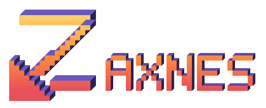
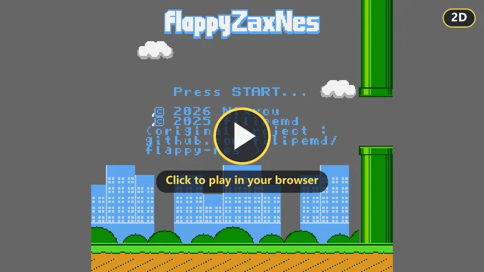

<p align="center">
  
</p>

# Zaxnes

**Zaxnes** is a free NES emulator that plays your games in 3D. The flat tiles and sprites of each
frame become little 3D blocks, in a scene with a real camera, lights and shadows: you can turn
around the level, zoom in, or go back to plain 2D at any time.

<p align="center">
  <a href="https://nixxou.github.io/zaxnes/?play=flappy">
    
  </a>
  <br>
  
</p>

It runs on **Windows**, **Linux**, **Android** (tablets and handhelds, with a gamepad or the touch
pad) and **handheld consoles** through PortMaster (Anbernic H700 devices such as the RG40XXV and
the RG35XX family, on muOS, Knulli or ROCKNIX).

- **Uses your 3dSen profiles.** Import them from your own 3dSen install in one click. 3dSen 2.0,
  2.1 and 2.2 profiles work too. Zaxnes also comes with a few profiles of its own (*Faxanadu*,
  *Metal Force*), and more are on the way. ([details](#the-3d-profiles))

And even without the 3D, it's a solid NES emulator:

- **Widescreen.** About 20 games show more of the level past the edges of the screen, like
  *Super Mario Bros. 3*, *Zelda II*, *Metroid* and the six *Mega Man*. ([details](#widescreen))
- **Accurate.** It's cycle accurate: compared cycle by cycle with a transistor-level simulation
  of the NES chips, its timing matches. Where the two still differ, tests made on real consoles
  side with Zaxnes. It passes all 147 AccuracyCoin tests and supports over 400 mappers, the
  Famicom Disk System included. ([details](#accuracy))
- **Or fast.** A fast core for small handhelds gives the same results with less CPU. You pick
  fast or accurate with one slider. ([details](#fast-or-accurate))
- **Extra cores.** FCEUX, and a NesHawk-compatible core that plays BizHawk TAS movies (`.bk2`)
  in sync. ([details](#three-engines))
- **The usual extras.** Rewind, save states, run-ahead, RetroAchievements and RetroArch shaders.
  ([details](#and-the-rest))

It's free and open source (GPL-3.0).

A word on how it's made: I built Zaxnes with heavy use of AI coding tools, on top of many
open-source projects (they're all listed in [THIRD-PARTY-NOTICES.md](THIRD-PARTY-NOTICES.md)).
I think it brings enough of its own to be worth a try next to them.

> **Independent project, not affiliated with Geod Studio or Nintendo. NES is a trademark of
> Nintendo.**

## The 3D profiles

How a game looks in 3D is set by a **3D profile**, one per game. Each frame, the flat tiles and
sprites become little 3D blocks in a scene with a camera, lights and shadows. You can turn around
the level, zoom in, or go back to plain 2D at any time.

### Most profiles come from 3dSen

The profiles are the work of the [3dSen](https://store.steampowered.com/app/1147940) team at Geod
Studio. Over a hundred NES games, each tuned by hand. 3dSen is the original idea Zaxnes owes
everything to, and it costs a few dollars. If you like NES games in 3D, buy it: that's how this
whole scene keeps going.

**[Get 3dSen on Steam](https://store.steampowered.com/app/1147940)**, then in Zaxnes use
**File ▸ Import from 3dSen…**. Zaxnes reads the profiles of *your* install and copies them into
your own profile folder. Nothing is downloaded, nothing is shared, and your 3dSen install is left
alone. On a handheld, run the import on a PC and copy the `profiles` folder to the card.

The import works with every version of 3dSen, **2.0, 2.1 and 2.2** included, and Zaxnes plays
what those versions added: reflections, bend, the new camera and Lua features.

### Profiles made for Zaxnes

[`rust/profiles/`](rust/profiles) holds 3D profiles made for Zaxnes itself: *Faxanadu* and
*Metal Force* so far, with more to come. Every package carries them and puts them in your profiles
at the first start.

Players also share free profiles in the
[Profile Repository](https://itch.io/board/872690/profile-repository) of the 3dSen Maker forum.
Import them with **File ▸ Import a profile…**.

Without a profile, every game still plays, in **2D**, or in a **default 3D** that gives every tile
the same depth.

### Try it at once: FlappyZaxNes

Zaxnes comes with one game, **FlappyZaxNes**: a small NES game made for it (after
[Flappy NES](https://github.com/filipemd/flappy-nes) by filipemd, GPL-3.0), with its own 3D profile
and widescreen. At the first start its ROM goes into your ROM folder and its profile into your
profiles: pick *FlappyZaxNes* in the ROM list and play. Delete them and they stay deleted, until a
new version of Zaxnes brings a new version of the game.

### Making your own profiles

Use [3dSen Maker](https://geod.itch.io/3dsen-maker), Geod Studio's free profile editor, then
import the profile in Zaxnes (**File ▸ Import a profile…**).

Zaxnes also has an **editor mode** (work in progress) for writing a profile in Lua with the help
of an AI agent. It gives the agent a local MCP server to look at the game and render it, and a
prompt ready to paste; see [`rust/docs/EDITOR.md`](rust/docs/EDITOR.md).

## Widescreen

Some games can be played in **16:9** (or 16:10, 3:2, or the shape of your window). The level and
the enemies show **past the edges of the original screen**, where the NES never drew them. It
works in 2D and in 3D.

Games supported so far:

- *Adventure Island*
- *Blaster Master*
- *Castlevania*
- *Excitebike*
- *Faxanadu*
- *Final Fantasy*
- *Kirby's Adventure*
- *Mega Man*, *Mega Man 2*, *3*, *4*, *5* and *6*
- *Metal Force*
- *Metroid*
- *Ninja Gaiden III*
- *Super Mario Bros.* and *Super Mario Bros. 3*
- *Zelda II: The Adventure of Link*
- *FlappyZaxNes* (the game that comes with Zaxnes)

Here's how it works. It isn't a recompilation: the game still runs on the emulated NES. Two
things make it work:

- a **small ROM hack applied in memory** to your own ROM when the game starts (nothing is written
  to your file, and Zaxnes ships no game data). It teaches the game to prepare the extra columns
  of the screen;
- **extra registers added to the emulated console**, which the hack uses to draw those columns
  past the original 256 pixels.

The hack is small and only touches what the screen needs, so it works with **most ROM hacks** of
these games: translations, difficulty or graphics hacks keep working in widescreen.

Some packs also offer **aids**, set per game or once for all of them in **Options ▸ Widescreen &
Hacks**: no slowdown, invincibility, a level select, and what the enemies in the new margins do
(move or wait until they're on the original screen, greyed while they wait).

**It's still experimental.** It works through most of these games, but expect glitches here and
there, mostly at the edges of the screen.

On the ROM list, the games that support it carry a **[W]**. **L1** (or the game's options) opens
its widescreen settings.

## Accuracy

Zaxnes aims to behave exactly like the console, down to the cycle.

- **Cycle accurate.** Its CPU bus, DMA and PPU were compared cycle by cycle with the
  transistor-level simulation of the NES chips (the 2A03 and 2C02 netlists): 421,901 CPU cycles,
  32,131 of them stolen by DMA, with **no timing difference**. The details are in
  [`docs/review/SUBCYCLE-PROOF.md`](docs/review/SUBCYCLE-PROOF.md).
- **AccuracyCoin: 147 of 147**, in all four CPU/PPU alignments a console can power on with.
- **Test ROMs** (blargg, holy-mapperel and others): 215 of the 219 that can be judged pass, each
  with the console model it was made for. The 4 that fail are expected: 3 test the MMC3's
  revision A, and `power_up_palette` checks a power-on state that varies between consoles.
- **Over 400 mappers**, the **Famicom Disk System**, the **VS. System** (with its cabinet buttons)
  and newer boards like the Rainbow.
- **PAL** measured on the netlist of the PAL chip (2C07), and Dendy.
- **The real video signal, if you want it.** In **Options ▸ NES picture**, Zaxnes can rebuild the
  console's video signal pixel by pixel and decode it like a TV: composite (the colour fringes and
  the dot crawl), S-Video or RF. You can also pick a TV: modern screen, or a measured tube (US,
  Japanese or PAL) with its own gamma and phosphors, and turn its tint, colour, contrast and
  brightness knobs.

An independent AI agent (Fable 5.2) then audited all of this with test programs of its own, run
on the same chip simulations. It agreed on the CPU (230 opcodes, dummy reads and writes
included), the DMA, the APU's frame counter and the test ROMs. It found five gaps. One was a real
bug and is fixed (`$2007` writes during rendering). For two of them, the simulation disagrees with
tests made on real consoles (AccuracyCoin, blargg's), so Zaxnes keeps what the console does. The
last two come from the test bench, or are exact in the Fidelity+ mode.

The few known gaps are listed, with their sources, in
[`docs/review/FIDELITY-LEADS.md`](docs/review/FIDELITY-LEADS.md).

## Fast or accurate

The **Essentials** tab of the options has one slider with five steps, from *Fastest* to *Most
faithful*. Each step sets the settings that cost speed: the core, run-ahead, the 3D effects, the
render scale, the video signal. You can still change any of them after.

- The **fast core** skips work the console's visible result doesn't need. It gives the same
  machine as the accurate core, checked frame by frame on 320 ROMs (save states, widescreen and
  run-ahead included), and needs less CPU. It's what small handhelds use by default.
- **Fidelity+** goes the other way: the console's finest details, at a small cost per frame.

The options also have a **simple mode**, with only the settings most people need, and an
**advanced mode** with everything, on the PC and on the console screen alike.

## Three engines

Each game can run on one of three engines, picked in its options:

- **Zaxnes**, the default, with everything on this page.
- **FCEUX**, the well-known emulator, built in.
- **NesHawk**, a core that behaves like BizHawk's. It plays BizHawk TAS movies (`.bk2`) in sync,
  and the widescreen and the hacks work on it too.

## And the rest

- **Rewind**, **save states** with thumbnails, **fast forward**. A widescreen game's save state
  loads with the widescreen on or off.
- **Run-ahead**, and an experimental **smooth scrolling at 120 Hz** that draws the playfield
  between two emulated frames.
- **RetroAchievements**, in softcore mode: save states, rewind and fast forward stay allowed. The
  ROM list shows how far you got in each game.
- **RetroArch shaders** (slang, through librashader) in Vulkan and DirectX 12, on the desktop and
  on Android. They're grouped by style (CRT Guest, Mega Bezel, CRT Royale, LCD…), each with a few
  simple options like curvature or scanlines. On the PC you can still edit every parameter.
- **Movies**: record a game and replay it exactly.
- A **console interface** made for the gamepad, on handhelds and on the desktop (F1), with a
  touch pad on Android.
- Vulkan and DirectX 12 on the desktop, besides OpenGL. In Vulkan, ReShade can use the depth of
  the 3D scene.

The user guide, in French, is [HOWTO-RUN.md](HOWTO-RUN.md): menus, shortcuts, options, where your
files go, and the command line. The handheld controls are in the
[PortMaster README](rust/build/portmaster/README.md).

## Licence and credits

Zaxnes is free software under the **GNU General Public License v3** ([LICENSE](LICENSE)). Part of
its 3D conversion is adapted from **3DNes_Engine** (© Geod Studio), an earlier version of that
engine published under the GPL-3.0; the files concerned say so. Zaxnes contains **no file taken
from 3dSen**.

Everything Zaxnes shows or plays is made by its own code: the skies, the interface sounds and the
font come from the program or from your system. [ASSETS-LICENSES.md](ASSETS-LICENSES.md) and
[THIRD-PARTY-NOTICES.md](THIRD-PARTY-NOTICES.md) list the assets and the third-party code.

> Since 0.3.0 Zaxnes is written in Rust. Versions 0.1.0 and 0.2.0 were written in C#; that code is kept
> on the [`archive-dotnetversion`](../../tree/archive-dotnetversion) branch.

## For developers

The code is a Cargo workspace in [`rust/`](rust):

```
cd rust
cargo build --release -p zax-app --features bundled
```

How to build the release packages, run the tests, and how the code is laid out are in
[`rust/README.md`](rust/README.md) (the technical part of the former README, moved there). The
widescreen's emulator side is described in
[`rust/docs/WIDESCREEN-EXTENSION.md`](rust/docs/WIDESCREEN-EXTENSION.md), and each game's hack in
[`rust/docs/hacks/`](rust/docs/hacks); the written specification is in [`docs/spec/`](docs/spec).

## Download

Every [release](../../releases) has one package per platform:

| Package | For |
|---|---|
| `Zaxnes-<version>-win-x64.zip` | Windows 10/11: a single `zaxnes.exe`, nothing to install; portable (its data in `userdata` next to it; delete `portable.txt` to use `%LOCALAPPDATA%\Zaxnes`) |
| `Zaxnes-<version>-linux-x64.tar.gz` | Linux (needs SDL2, `libsdl2-2.0-0` on Debian/Ubuntu) |
| `Zaxnes-<version>-portmaster-aarch64.zip` | PortMaster handhelds: unzip into the `ports` folder of the SD card |
| `Zaxnes-<version>-android-arm64.apk` | Android 7.0 or later, 64-bit ARM (tablets and handhelds): install the APK |
| `Zaxnes-<version>-libretro-win-x64.zip` | RetroArch on Windows: the libretro core; `zaxnes_libretro.dll` goes in RetroArch's `cores` folder, `zaxnes_libretro.info` in its `info` folder (see [`rust/crates/zax-libretro/README.md`](rust/crates/zax-libretro/README.md)) |
| `Zaxnes-<version>-libretro-linux-x64.zip` | RetroArch on Linux: the same core, `zaxnes_libretro.so` |

**The only game included is FlappyZaxNes**, with its 3D profile (see above); the 3D profiles made
for Zaxnes come with every package. For any other game you need your own, legally owned ROMs.
